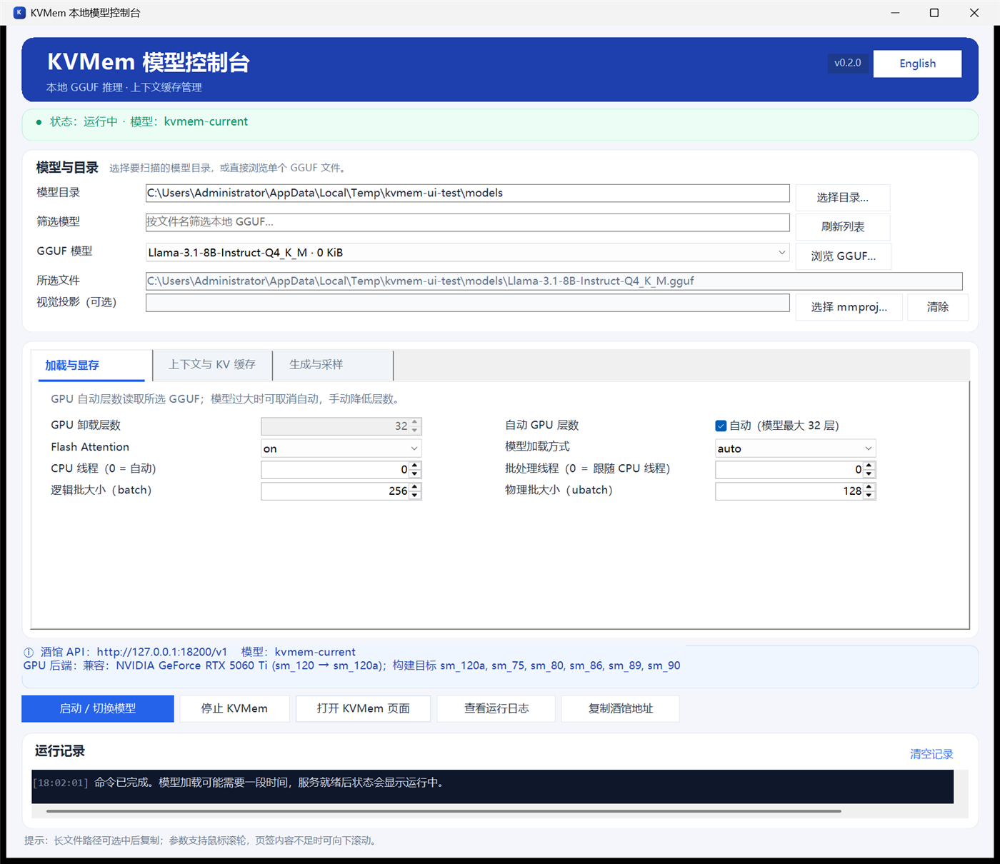

# KVMem 可视化后端 · Windows 桌面控制器

> **KVMem Visual Backend** — 给 [KVMem](https://github.com/kvmem/kvmem) 本地推理服务套一个 Windows 图形界面，负责选模型、配参数、启停服务、看日志。
>
> 本项目是**第三方社区前端**，不是 KVMem 官方项目，也不修改上游代码。

**上游项目：<https://github.com/kvmem/kvmem>**
> KVMem virtualizes KV memory across inference backends to make ultra-long-context local AI accessible on limited hardware.



---

## 这个项目解决什么问题

KVMem 通过 `llama-kvmem-server.exe` 提供 OpenAI 兼容接口，但日常使用要背一堆命令行参数：上下文长度、KV 缓存预算、GPU 卸载层数、批大小、采样参数……换一个模型就要重新拼一遍。

这个控制器把这些参数做成一个单窗口面板：

- 自动扫描本地 GGUF，读出模型层数，自动决定 GPU 卸载层数
- 三个参数页签，**全部参数一屏可见**，不用滚动
- 一键启动 / 停止 / 切换模型，实时显示服务状态
- 中英文一键切换，选择会保存
- 内置运行日志查看器，出错能直接定位

它只做"调度和界面"，真正的推理仍然由上游 KVMem 的 llama.cpp 后端完成。

---

## 功能一览

| 模块 | 说明 |
|---|---|
| 模型管理 | 扫描目录、按名称筛选、单独浏览某个 GGUF、可选 `mmproj` 视觉投影 |
| 显存与加载 | 自动/手动 GPU 卸载层数、Flash Attention、模型加载方式、CPU 线程、逻辑/物理批大小 |
| 上下文与 KV 缓存 | 上下文长度、KVMem GPU 缓存预算、CPU 缓存大小、KV 精度、生成预留 |
| 生成与采样 | 最大生成长度、温度、Top-P、Top-K、Min-P、重复/存在/频率惩罚、随机种子、思考模式 |
| 服务控制 | 启动/切换、停止、打开 KVMem 网页、复制酒馆地址 |
| 诊断 | 状态卡片（五档配色 + 忙碌进度条）、深色活动日志、日志查看器、GPU 兼容性检查 |
| 界面 | 中英双语、DPI 自适应、快捷键 `Ctrl+Enter` 启动、`F5` 刷新 |

---

## 使用说明

### 方式一：便携包

> 从 [Releases](https://github.com/Faker123546789/KVMem-Windows-Controller/releases/latest) 下载 `KVMem-Windows-Controller-Portable-v*.zip`（约 785 MB，已内含 KVMem 后端与 PowerShell 7，不含模型）。

1. 解压到**纯英文路径**，例如 `D:\KVMem`。中文路径可能让后端加载失败。
2. 把 `.gguf` 模型放进 `models` 文件夹（也可以放在任意位置，之后在界面里选）。
3. 双击 `Open-KVMem-Controller.bat`。
   - 首次启动会自动校验并解压 `payloads` 里的两个压缩包，生成 `runtime\` 与 `.tools\pwsh\`（约 1.8 GB，需要等一会儿）。
4. 在界面里选模型 → 调参数 → 点 **启动 / 切换模型**。
5. 状态变成 `运行中` 后，把酒馆地址 `http://127.0.0.1:18200/v1` 填进 SillyTavern 或任意 OpenAI 兼容客户端。

停止服务用界面上的 **停止 KVMem**，或命令行执行 `pwsh -File .\Stop-KVMem.ps1`。

### 方式二：从源码运行（推荐给开发者）

```powershell
# 1. 需要 PowerShell 7
pwsh -v

# 2. 准备 KVMem 运行时，目录结构必须是：
#    runtime\bin\llama-kvmem-server.exe
#    runtime\share\kvmem\ui

# 3. 启动界面
pwsh -STA -File .\KVMem-Controller.ps1
```

也可以直接命令行启动后端：

```powershell
pwsh -File .\Start-KVMem.ps1 -Model "D:\models\Qwen2.5-7B-Instruct-Q4_K_M.gguf"
pwsh -File .\Start-KVMem.ps1 -?    # 查看全部参数
```

### 第一次使用建议

1. 先点 **刷新列表**，确认模型被识别。
2. 看 **GPU 卸载层数**：默认自动读取模型层数，显存不够就取消"自动"再手动调低。
3. 上下文长度不要一上来拉满，先 8192 试，稳定后再加。
4. 启动后看活动日志，有报错会写在这里，也可以点 **查看运行日志** 看后端 stdout/stderr。

---

## 参数说明（容易踩坑的几个）

| 参数 | 含义 | 建议 |
|---|---|---|
| GPU 卸载层数 | 放到显卡上的 Transformer 层数，`-1` 表示全部 | 显存够就拉满；OOM 就减半再试 |
| 上下文长度 | 一次能容纳的 token 数 | 8K→16K→32K 逐步加，显存和 KV 缓存都要跟着涨 |
| KVMem GPU 缓存预算 | KVMem 在显存里保留的 KV 缓存 token 上限 | 越大越省显存换速度，太小会频繁换出 |
| KVMem CPU 缓存 (GiB) | 放在内存里的 KV 缓存 | 内存充足可给 2–8 GiB |
| KV 缓存精度 | `f16` / `q8_0` / `q5_0` / `q4_0` | `q8_0` 基本无损且省一半显存 |
| 逻辑/物理批大小 | batch / ubatch | 默认 256 / 128，显存紧张先降 ubatch |
| 生成预留 | 给回复预留的 token | 至少要大于你期望的单次回复长度 |
| 思考模式 | 是否禁用推理模型的思考段 | 普通模型选"禁用思考"响应更快 |

> 采样参数只是**服务端默认值**。SillyTavern 请求里带的 `temperature`、`top_p` 等会覆盖这里的设置。

---

## 接口

- 地址：`http://127.0.0.1:18200/v1`
- 只监听 `127.0.0.1`，不对外网开放
- 模型别名：`kvmem-current`
- 兼容 OpenAI 的 `/v1/chat/completions`、`/v1/models`

SillyTavern 填法：API 选 `OpenAI`，反向代理填 `http://127.0.0.1:18200/v1`，模型名随便填（服务端只有一个模型）。

---

## 环境要求

- Windows 10/11 x64
- PowerShell 7（便携包已内置）
- NVIDIA 显卡 + 较新的驱动（本项目锁定的后端是 CUDA 13.2.86 构建）
- 显存 ≥ 模型大小 + KV 缓存开销

### GPU 兼容性

启动时控制器会调用 `llama-kvmem-server.exe --list-devices` 枚举 CUDA 设备，并与后端的编译目标比对：

| NVIDIA 世代 | 计算能力 | 锁定的后端 |
|---|---:|---|
| RTX 10（Pascal） | `sm_61` | 不支持，启动前拦截并说明 |
| RTX 20（Turing） | `sm_75` | 支持 |
| RTX 30（Ampere） | `sm_86` | 支持 |
| RTX 40（Ada） | `sm_89` | 支持 |
| RTX 50（Blackwell） | `sm_120a` | 支持 |

这只代表**编译目标匹配**，不代表任何模型都塞得进显存，也不代表每张卡都做过推理实测。

---

## 常见问题

**启动后状态一直是"未就绪"**
看活动日志和 **查看运行日志**。常见原因：显存不够、模型路径含中文、端口被占用、驱动版本过旧。

**提示 18200 端口被其他程序占用**
控制器只会停止自己启动的进程，不会误杀别的程序。先确认是谁占用：`Get-NetTCPConnection -LocalPort 18200 -State Listen`。

**界面模糊 / 控件被裁切**
程序会按系统 DPI 缩放。如果改过缩放比例，重启一次控制器即可。

**模型列表是空的**
确认 `models` 目录里有 `.gguf` 文件，或点 **选择目录** 换一个位置。目录不存在时程序会自动创建。

**换模型后报 OOM**
降低 GPU 卸载层数，或把上下文长度和 KV 缓存预算调小。

---

## 目录结构

```
KVMem-Windows-Controller/
├─ KVMem-Controller.ps1      主界面
├─ KVMem-Localization.psm1   中英文案
├─ KVMem-Compatibility.psm1  GPU 兼容性检查
├─ Start-KVMem.ps1           启动后端
├─ Stop-KVMem.ps1            停止后端
├─ Open-KVMem-Controller.bat 双击入口
├─ assets/kvmem.ico          图标
├─ docs/ui-preview.png       界面预览
├─ models/                   放 GGUF（不入库）
├─ runtime/                  KVMem 后端（不入库）
└─ codex/logs/               运行日志（不入库）
```

---

## 开发说明

- 界面：WinForms + PowerShell 7，无第三方依赖
- 缩放：`AutoScaleMode = None` + 自定义 `Px()` 按 `DeviceDpi/96` 缩放
- 所有 UI 文案走 `KVMem-Localization.psm1`，新增文案请同时补中英两条
- 修改后至少验证：语法解析、三个页签在中英文下是否完整可见、启动/停止全流程

```powershell
# 语法检查
$e=$null; [System.Management.Automation.Language.Parser]::ParseFile(
  (Resolve-Path .\KVMem-Controller.ps1), [ref]$null, [ref]$e) | Out-Null
if ($e) { $e } else { 'parse OK' }
```

日志、进程号、模型文件都在 `.gitignore` 里，不会被提交。

### 构建便携包

`payloads` 目录不随仓库分发，需要先把两个上游压缩包放进去（文件名必须一致）：

| 文件 | 来源 |
|---|---|
| `kvmem-v0.16.0-rc3-windows-x86_64-cuda13.2.86.zip` | [KVMem releases](https://github.com/kvmem/kvmem/releases/tag/v0.16.0-rc3) |
| `PowerShell-7.6.7-win-x64.zip` | [PowerShell releases](https://github.com/PowerShell/PowerShell/releases/tag/v7.6.7) |

然后执行：

```powershell
pwsh -File .\Build-Portable.ps1
```

脚本会复制源代码与两个 payload、打成 `dist\KVMem-Windows-Controller-Portable-v<版本>.zip`，并校验必需条目齐全、没有混入日志或模型。版本号取自 `package-manifest.json`。

---

## English summary

A Windows desktop GUI for the [KVMem](https://github.com/kvmem/kvmem) local inference server. Pick a GGUF model, tune VRAM / KV cache / sampling settings, start or stop the backend, and watch the logs — without typing llama.cpp flags.

- Three settings tabs, all parameters visible without scrolling (125–200% scaling tested)
- Automatic GGUF layer detection for GPU offload, bilingual UI (中文 / English)
- `Ctrl+Enter` to start, `F5` to refresh
- Endpoint: `http://127.0.0.1:18200/v1`, loopback only

This is an independent community launcher. It does not modify KVMem, LM Studio, or any upstream project. See [Quick start](#使用说明) above (Chinese) for details.

---

## 致谢与许可

- 推理后端、`llama-kvmem-server.exe`、CUDA 运行时均来自 [KVMem](https://github.com/kvmem/kvmem)，版权归上游作者所有，按其各自许可使用。
- PowerShell 运行时来自 [PowerShell](https://github.com/PowerShell/PowerShell)。
- 本仓库中的控制器与启动脚本使用 MIT License，见 [LICENSE](LICENSE)。
- 第三方组件声明见 [THIRD-PARTY-NOTICES.md](THIRD-PARTY-NOTICES.md)。

如果这个项目对你有用，请先去给上游 [KVMem](https://github.com/kvmem/kvmem) 点个 Star。
